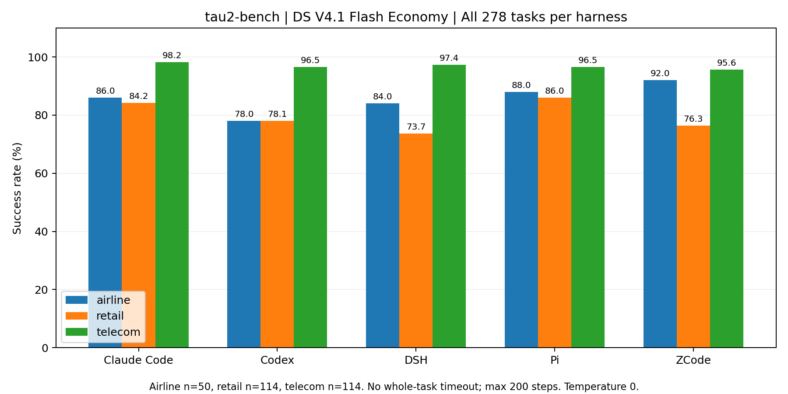
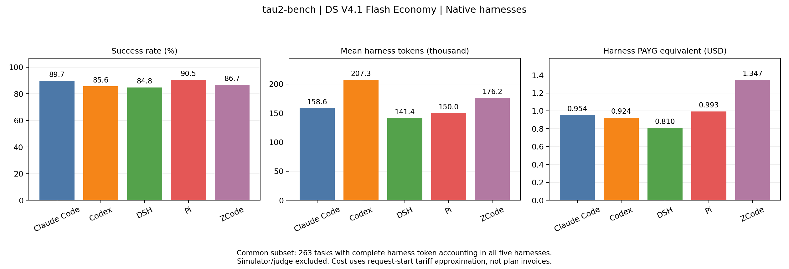

# tau2-bench — dsv41flash-economy-t0-native-notimelimit-v3-dialogue

五组均完成 **278/278**，共 **1,390 个二元标签**，无 pending 样本。
airline/base 50 题、retail/base 114 题、telecom/base 114 题；trial=0，每题仅一个目标 trial。
本轮运行跨 2026-10-29 至 2026-10-30，保留全部基础设施重试尝试。

|Harness|成功 / 278|成功率|Harness token|模拟用户 token|评判器 token|Harness 等价 USD|含辅助等价 USD|
|---|---:|---:|---:|---:|---:|---:|---:|
|Claude Code|251|90.29%|44,328,775|13,564,992|169,344|$1.0174|$1.4702|
|Codex|238|85.61%|57,890,341|14,141,345|159,618|$1.0501|$1.4214|
|DeepSeek Harness|237|85.25%|39,489,860|12,981,256|168,839|$0.8560|$1.1860|
|Pi|252|90.65%|41,963,696|13,277,724|168,841|$1.0514|$1.4032|
|ZCode|242|87.05%|49,799,314|13,804,335|171,724|$1.4508|$1.8709|

主 harness 合计 **233,471,986 token**，模拟用户 **67,769,652**，评判器 **838,366**。
已观测的按量付费等价成本：harness 约 **$5.4257**，包含模拟用户/评判器约 **$7.3517**。
**这是已知 token 的公开单价折算，不是 Coding/Agent Plan 的实际套餐支出。** 所有组均有少量计量缺口。

## 逐题数据

- [samples.csv](samples.csv) / [samples.jsonl](samples.jsonl)：完整 `(token, success)`、分项用量、费用、评分来源及质量标记。
- [router-data.csv](router-data.csv)：训练简表；`task_id` 使用 `domain/original_task_id`，防止 airline/0 与 retail/0 冲突。
- [task-matrix.csv](task-matrix.csv)：278 题五组正误/token 并排；[pairwise-correctness.csv](pairwise-correctness.csv)：两两交集。
- [requests.csv](requests.csv) / [JSONL](requests.jsonl)：逐请求账本，`role=model/simulator/judge` 分开。
- [attempts.csv](attempts.csv) / [JSONL](attempts.jsonl)：逐尝试执行、官方评分摘要与三种角色的用量。
- [tasks.csv](tasks.csv)：官方任务 ID、domain、base split、原始任务记录哈希和 telecom 问题/persona 标签。
- [experiments.json](experiments.json)、[pricing.json](pricing.json)、[analysis.json](analysis.json)、[来源记录](provenance/source-files.json)。
- 逐组人类可读明细：[Claude](harnesses/claude.md)、[Codex](harnesses/codex.md)、[DSH](harnesses/dsh.md)、[Pi](harnesses/pi.md)、[ZCode](harnesses/zcode.md)。

## Domain 结果

|Harness|Domain|成功 / 已评分|成功率|Harness token|计量完整题|
|---|---|---:|---:|---:|---:|
|Claude Code|airline|43/50|86.00%|6,741,254|48|
|Claude Code|retail|96/114|84.21%|14,381,954|113|
|Claude Code|telecom|112/114|98.25%|23,205,567|114|
|Codex|airline|39/50|78.00%|9,743,031|49|
|Codex|retail|89/114|78.07%|17,288,470|114|
|Codex|telecom|110/114|96.49%|30,858,840|112|
|DeepSeek Harness|airline|42/50|84.00%|5,936,700|49|
|DeepSeek Harness|retail|84/114|73.68%|12,327,439|114|
|DeepSeek Harness|telecom|111/114|97.37%|21,225,721|112|
|Pi|airline|44/50|88.00%|7,523,009|49|
|Pi|retail|98/114|85.96%|12,917,501|111|
|Pi|telecom|110/114|96.49%|21,523,186|113|
|ZCode|airline|46/50|92.00%|8,686,737|48|
|ZCode|retail|87/114|76.32%|14,751,991|113|
|ZCode|telecom|109/114|95.61%|26,360,586|113|

## 模型、预算与适配

请求模型别名 `deepseek-v4.1-flash-economy`，模型/模拟用户/评判器 temperature 均为 0。
Claude、Codex、DSH 使用 Coding Plan；Pi、ZCode 使用 Agent Plan。模拟用户和 retail NL assertion judge 均使用 Coding Plan 的同一 DS 模型。
各原生 harness 保持默认上下文管理，没有统一 64k 阈值，也不向 native CLI 注入自动“继续思考”来改变其退出决策。
使用原生 Claude 2.1.301、Codex 0.161.0、DSH 0.2.1-rc.2、Pi 1.3.0、ZCode 0.16.9。

**没有整题 wall-clock 时间上限**（`timeout=null`），官方 orchestrator 最多 **200 步、10 次工具错误**，seed=300。
无整题超时不代表没有网络超时/请求重试或传输保护：单次 MCP 调用仍有 3600 秒 guard，
CLI 启动/握手及 API 请求保留其各自网络超时。本轮没有把 Terminal 的 1200 秒预算套用到 tau2。

使用本机 [sierra-research/tau2-bench](https://github.com/sierra-research/tau2-bench) 的官方环境、orchestrator 和评价器，
外层 MCP 提供原 domain 工具与 `start/send_message/finish`，原生 CLI 不接触隐藏场景、参考动作或评分标准。
适配层在第一次推理前启动官方模拟用户；普通最终文本等价于发送给用户，用户回复通过原 CLI session resume 继续。
模拟用户执行其官方手机操作工具，judge 检查 retail NL assertions。
这是自定义基座/模拟用户配置，**不是官方排行榜配置的复现**；同一模型别名也不证明套餐端点的服务配置完全一致。

本地源代码/数据使用哈希固定，而不是捏造一个未记录的 Git commit：

- tau_source_sha256: `ba660b83148679604d112069da128f3b89ae5720ce519da7234b1854b8f821bf`
- tau_data_sha256: `6e282721b4b247e1353128ee64eb6ec8fc88ec69c30456d9c818db399ac32d7a`

原始任务记录仅发布确定性 JSON 哈希，不公开任务正文、私有用户场景、参考动作、对话或 judge 输入。
上游源码/数据权限遵循原项目；这些哈希不能单独恢复未公开的原始文件。

## 标签来源与修复历史

**1,361 条来自官方轨迹评价**：`success=int(reward == 1.0)`。剩余 **29 条**是原生 CLI 在用户初始化成功后
干净退出、没有完成交互，按本实验规则记为 `success=0`、`termination_reason=harness_early_exit`。
这 29 条没有官方 reward，`score/official_reward` 保持 null，但二元失败标签有效；不会伪造官方评分。
各组提前退出：Claude 0、Codex 5、DSH 12、Pi 4、ZCode 8。`failure_kind` 和 `label_source` 明确区分。
纯基础设施错误没有被转成零分，而是保留尝试、修复后重跑；最终 1,390 个标签均已有结束状态。

实验经历最小外围修复，包括：ZCode 等待 MCP 工具就绪；统一 `start` 初始化；普通文本自动转交及原生 session resume；
模拟用户 text+tool 的 half-duplex 转换；无效/截断模拟用户响应重试；Pi `agent_settled` 退出识别；
`send_message` 缺失/非字符串 text 的可恢复错误不再永久污染会话。
这些是**实验运行期间的不同实现版本**，不能仅以最终实现指纹声称所有样本都在完全相同的适配版本上执行。
保留每组 [implementation-updates](provenance/implementation-updates) 记录的时间与前后哈希；
已有成功/失败标签未在本次导出中重评或静默改写，历史尝试 token 计入主消耗。

## 用量、费用和公平比较

主 `token` = 全部已观测 **harness** 请求的非缓存输入 + 缓存读取 + 缓存创建 + 输出，包含较早尝试。
模拟用户/评判器分别在 `simulator_*` / `judge_*` 中统计；`end_to_end_tokens` 才把三者相加。
部分任务不需要 judge：0 次 judge 请求表示不适用，`judge_applicable=false`，计量完整，不是缺失调用。
`final_attempt_token` 是最终一次执行的已观测 harness 用量，可用于排除较早基础设施重试开销的研究。

与 Terminal 发布相同，按 [方舟公开价格](https://docs.volcengine.com/docs/ark/model-pricing?lang=zh)（2026-10-30 核查）重算：
闲时 CNY/百万 token 为输入 0.80、缓存读取 0.016、输出 3.20；高峰为其两倍。
高峰是北京时间周一至周五 09:00–12:00、14:00–18:00；价格按请求**完成**时段生效，
但代理 start/finish 的 `time` 均保存请求**开始**时间，所以当前费用按开始时间近似划分峰谷。
另有全闲时/全高峰统一价格场景。换汇使用 ECB 2026-10-29 的 EUR/USD=1.1130、EUR/CNY=7.4144。
没有实际订阅费用分摊依据，`actual_billed_usd=null`。计量缺口的未知 token 未估填为 0，
费用只计已知 token，不是完整账单或其可靠上下界。详细公式、来源和汇率精度见 [pricing.json](pricing.json)。

五组共同完整 **harness** 计量子集为 **263** 题；
要求模拟用户/评判器也完整的共同子集为 **253** 题。
完整计量筛选可能引入选择偏差，请与全 278 题结果并列报告。
81 题至少一组成功、另一组失败；
190 题五组都成功，7 题五组都失败。
事后至少一组成功的 oracle 覆盖为 271/278；这不是已训练 router 的成绩。

图表使用五组共同完整计量的 harness 子集，逐域图使用全部 278 题；对应 SVG 同目录可下载。
训练/测试按 `task_id` 分组，同题五行不能拆开。保留成功和失败，按研究目的选择全部尝试或最终尝试 token，
并报告对计量不完整记录的处理。字段补充见 [DATA_FORMAT](../../../docs/DATA_FORMAT.md)。

## 校验

仓库根目录运行 `python tools/validate_release.py`，可同时核验 Terminal 和 tau2 数据。
本目录可运行 `sha256sum -c SHA256SUMS`。导出脚本只读本机结果，不启动模型、模拟用户或评分调用。
