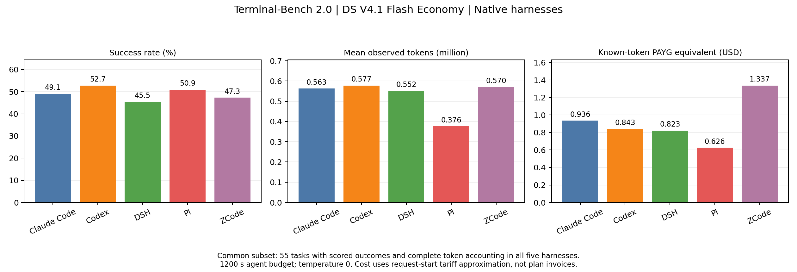

# Terminal-Bench 2.0 — dsv41flash-economy-t0-native-1200-v1

本轮采集于 2026-10-27 至 2026-10-30，89 道任务、5 个 harness、445 行，444 个二元标签。
保留原实验标签，重新从冻结请求账本核算所有尝试的 token；结果未做挑题或补造标签。

|Harness|正误已评分|成功率（已评分）|已观测 token|严格计量完整题|API 等价美元估算*|
|---|---:|---:|---:|---:|---:|
|Claude Code|35/89|39.33%|48,513,862|75/89|$1.6105|
|Codex|43/89|48.31%|55,791,414|86/89|$1.6416|
|DeepSeek Harness|32/89|35.96%|44,894,171|80/89|$1.4786|
|Pi|37/88|42.05%|30,958,097|78/89|$1.1455|
|ZCode|32/89|35.96%|48,772,944|79/89|$2.2590|

五组累计已观测 **228,930,488 token**，按开始时间近似折算 **$8.1352**。

## 查看逐题结果

- [Claude Code](harnesses/claude.md)、[Codex](harnesses/codex.md)、[DSH](harnesses/dsh.md)、[Pi](harnesses/pi.md)、[ZCode](harnesses/zcode.md)：每题正误、分项 token、退出原因、费用和计量标记。
- [samples.csv](samples.csv) / [samples.jsonl](samples.jsonl)：完整长表；[router-data.csv](router-data.csv)：训练简表。
- [task-matrix.csv](task-matrix.csv)：每题五组并排；[pairwise-correctness.csv](pairwise-correctness.csv)：两两正误交集。
- [requests.csv](requests.csv) / [requests.jsonl](requests.jsonl)：逐请求账本；[attempts.csv](attempts.csv) / [attempts.jsonl](attempts.jsonl)：逐尝试执行证据和成本。
- [tasks.csv](tasks.csv)：任务类别、难度及资源；[experiments.json](experiments.json)：版本与配置指纹。
- [analysis.json](analysis.json)：共同子集、分歧题、全超时题、对账差异；[summary.json](summary.json)：可编程汇总。

## 实验和评分规则

请求模型别名 `deepseek-v4.1-flash-economy`，temperature=0；使用各原生 CLI 的执行循环和默认压缩策略，
没有强制 64k 压缩阈值。上下文容量元数据和 CLI 版本见配置；各 harness 的默认上下文管理并不相同。
没有服务端权重哈希，不能仅凭同一别名证明各套餐、各时间点的后端实现完全一致。
套餐路由、请求等待及适配修复是本次比较的限制。

每题 agent 上限 1200 秒；Harbor Docker 环境，任务资源与 verifier 预算以任务设置为基础。
为受限网络配置了国内 apt 镜像、缓存资源和离线 verifier 依赖。
原生不支持 Responses 的 CLI 使用 Messages→Responses 协议转换；Codex 原生使用 Responses。
实验中包含传输修复和断点重跑，相关配置哈希快照见 [provenance/experiment-history](provenance/experiment-history)。
CLI 版本为 Claude 2.1.301 / Codex 0.161.0 / DSH 0.2.1-rc.2 / Pi 1.3.0 / ZCode 0.16.9。
上游任务仓库 [harbor-framework/terminal-bench-2](https://github.com/harbor-framework/terminal-bench-2)，
记录的 commit 为 `69671fbaac6d67a7ef0dfec016cc38a64ef7a77c`；本地执行资产存在离线适配。
原任务 instruction/task.toml 的 SHA256 和实际 Harbor task checksum 分别保留，未声称本轮与官方榜单环境完全相同。

正常结束由 verifier reward 确定 0/1；agent 超时按实验规则置 0（`agent_timeout_zero_v2`）。
DSH 和 Pi 的 `pytorch-model-cli` 各有一条 verifier 超时置 0（`verifier_timeout_zero_v1`）。
Pi 的 `compile-compcert` 因 exit 137（SIGKILL）保持 `success=null`，不推断为模型错误，也不认定具体是 OOM。
本轮因此是 444 个标签，而不是 445 个。

任务 token 是所有已观测尝试的总消耗；最终标签来自最终执行。
基础设施失败后的重跑不是随机独立重复采样，也不是 pass@k。原生工具/调用策略保持各自行为。
显式摘要压缩事件的现有观测均为 0：可作为原生 harness 的预算内效率基线，不能据此给压缩算法排名，
也不能证明每个 harness 都没有内部裁剪。

## 费用如何计算

按 [火山方舟公开模型价格](https://docs.volcengine.com/docs/ark/model-pricing?lang=zh)（2026-10-30 核查）重算；单位 CNY / 1M token：

|时段|非缓存输入|缓存命中|输出|
|---|---:|---:|---:|
|闲时|0.80|0.016|3.20|
|高峰|1.60|0.032|6.40|

高峰为北京时间周一至周五 09:00–12:00、14:00–18:00，其余为闲时。
逐请求费用 = `(非缓存输入 × 输入单价 + 缓存读取 × 缓存单价 + 输出 × 输出单价) / 1,000,000`。
缓存已经与非缓存输入分开，不重复扣减或计费；本轮缓存创建记录均为 0。

官方按**请求完成时间**划分峰谷；现有代理 start/finish 记录中的 `time` 都是请求开始时间，
故 `payg_known_start_time_estimate_*` 仅以开始时间作近似。另提供全闲时、全高峰重算，便于统一价格比较。
价格为本次查到的公开价重算，不是经核验的历史账单价，也没有应用订阅活动优惠。

美元统一使用 [ECB 2026-10-29 汇率](https://www.ecb.europa.eu/stats/eurofxref/eurofxref-daily.xml)：
EUR/USD = 1.1130，EUR/CNY = 7.4144，得到 1 USD = 6.6616352201 CNY。
这是跨币种展示换算，不是交易执行价；完整费率、汇率及来源见 [pricing.json](pricing.json)。

[官方套餐说明](https://docs.volcengine.com/docs/ark/agent-plan-personal-faq?lang=zh)区分订阅额度/AFP 与按量单价。
**本实验使用套餐，因此无法从 token 得出实际支出的美元；`actual_billed_usd` 保持空值。**
计量不完整的费用仅覆盖已知 token，全闲时/全高峰场景也不是完整账单的上下界。
Harbor/harness 自报美元额可能套用其他费率，单独保留为 unverified，没有用于上述估算。

## 共同子集和 router 信息

五组共同已评分 **88** 题；共同全部请求计量完整 **55** 题。
有 **37** 道题出现至少一组成功、另一组失败；
共同已评分题中 **35** 道五组均失败，其中全题集中 **29** 道五组均 agent 超时。
共同已评分题的事后“至少一组能成功”覆盖 53/88；这是 oracle 覆盖率，不是训练好的 router 成绩。

图仅使用五组共同完整计量的 55 题；选择完整计量子集可能有选择偏差，不能代替全题集结果。
独立可导出的 [SVG](figures/common-subset.svg) 同时提供。
字段、训练划分、主 token / 最终尝试 token 的选择见 [DATA_FORMAT](../../../docs/DATA_FORMAT.md)。

## 对账与来源

DSH 的 `write-compressor` 历史导出为 632,384 token；原始请求账本重算为 678,702，增加 **46,318**。
本发布使用账本重算值，保留 `source_export_total_tokens` 和 `token_reconciliation_delta`。
这说明历史导出与最终账本不同，不据此猜测具体写入竞态，也没有改写本地历史结果。

[provenance/source-files.json](provenance/source-files.json) 保存读取时原始文件的 SHA256 和长度，
支持持有原始日志的人核验。仓库只公开白名单指标，不包含对话、工具输入、标准答案或凭证。
`python tools/validate_release.py` 可在仓库根目录核验逐请求→逐尝试→逐样本→汇总的一致性。
`SHA256SUMS` 可在本目录用 `sha256sum -c SHA256SUMS` 校验。
